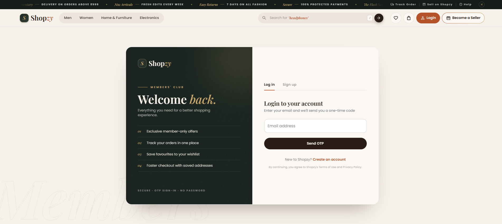

# 🛒 Shopzy — Smart Commerce


**Shopzy** is a full-stack, multi-vendor e-commerce platform built with **Java Spring Boot** and **React + TypeScript**. It has separate experiences for **customers, sellers and admins**, with email-OTP login, Razorpay payments, an AI shopping assistant (Google Gemini) and a clean editorial-style UI.

---

## 📸 Screenshots

| Homepage | Login |
|---|---|
|  |  |

---

## 👨‍💻 Project Information

| Category | Details |
|---|---|
| Developer | Raghav Pareek |
| Project | Shopzy — Smart Commerce |
| Type | Full Stack Web Application (Final Year Project) |
| Architecture | REST API + React SPA |
| Backend | Java 17, Spring Boot 3.3 |
| Frontend | React + TypeScript (Vite) |
| Database | MySQL |

---

## ✨ Highlights

- 🔐 **Passwordless login** — OTP sent to email, then JWT-based sessions
- 🤖 **AI shopping assistant** — chatbot powered by Google Gemini
- 💳 **Razorpay payments** — payment links with verification on success
- 🚚 **Smart pricing** — coupons, discounts, free delivery above ₹999 (₹79 otherwise), same on frontend and backend
- 🏪 **Multi-vendor** — sellers manage their own products, orders and reports
- 🛠️ **Admin panel** — seller approval, coupons, deals and homepage management
- 🧪 **Unit tests** — 30 JUnit 5 + Mockito tests (auth, JWT, cart, wishlist, discounts, OTP)
- 🗂️ **Demo data seeder** — fills every category with realistic demo products on startup

---

## 🧱 Technology Stack

**Backend:** Java 17 · Spring Boot · Spring Security · JWT · Spring Data JPA · Hibernate · Java Mail Sender · Lombok · Maven · Razorpay SDK · Google Gemini API

**Frontend:** React · TypeScript · Vite · Redux Toolkit · React Router · Axios · Tailwind CSS · Material UI · Formik · Yup

**Database:** MySQL

**Testing:** JUnit 5 · Mockito · AssertJ

---

## ✨ Features

### 👤 Customer
- Sign up / login with email OTP
- Browse, search, filter, sort and paginate products
- Mega-menu categories (Men, Women, Home & Furniture, Electronics)
- Product details with gallery, offers, delivery estimate and reviews
- Cart, wishlist, coupons
- Address management and checkout
- Online payment via Razorpay
- Order history, order tracking and cancellation
- Reviews and ratings
- AI chatbot for product help

### 🛍️ Seller
- Seller registration with email verification
- Seller dashboard with sales charts
- Add, update and delete products
- Inventory and order management
- Earnings, transactions and reports
- Seller profile management

### 🛠️ Admin
- Admin dashboard
- Seller approval / suspension
- Coupon management
- Deals and homepage category management

---

## 🗂️ Backend Architecture

```
Controller  →  Service  →  Repository  →  MySQL
```

Additional layers: DTO · Model (Entity) · Mapper · Request/Response · Exception handling · Security config · AI service · Utils

```
com.raghav.ecommerce
├── ai            # Gemini chatbot
├── config        # Security, JWT, CORS, demo data seeder
├── controller
├── domain        # Enums (roles, order/payment status ...)
├── dto
├── exception
├── mapper
├── model
├── repository
├── request
├── response
├── service
├── utils
└── EcommerceApplication.java
```

**Core entities:** User · Seller · Product · Category · Cart · CartItem · Order · OrderItem · Address · PaymentOrder · Transaction · Coupon · Wishlist · Review · VerificationCode · SellerReport · Deal · HomeCategory

---

## 🔄 Application Flow

```
React UI → Redux Thunk → Axios → Spring Boot REST API
        → Controller → Service → Repository → MySQL
        → JSON response → Redux state → UI
```

**Payment flow:** Cart → Address → Razorpay payment link → `/payment-success` → backend verifies the payment → order marked **PLACED** and cart cleared.

---

## 📁 Project Structure

```
smart-commerce/
├── backend/          # Spring Boot API
│   ├── src/main/java/com/raghav/ecommerce
│   ├── src/main/resources/application.properties.example
│   ├── src/test/java # unit tests
│   └── pom.xml
├── frontend/         # React + TypeScript (Vite)
│   ├── src/
│   └── package.json
├── assets/images/    # screenshots
└── README.md
```

---

## 🚀 Getting Started

### Prerequisites
- Java 17
- Node.js 18+ and npm
- MySQL 8

### 1. Clone
```bash
git clone https://github.com/raghavpareek0103/smart-commerce.git
cd smart-commerce
```

### 2. Backend
```bash
cd backend
```
Copy the example config and fill in your own values:
```bash
# Windows (PowerShell)
Copy-Item src\main\resources\application.properties.example src\main\resources\application.properties
# Linux / macOS
cp src/main/resources/application.properties.example src/main/resources/application.properties
```

You will need:
- a MySQL database and its username/password
- a Gmail address + [App Password](https://myaccount.google.com/apppasswords) (for OTP emails)
- Razorpay **test** keys (Dashboard → Settings → API Keys)
- a Google Gemini API key (for the chatbot)

Run:
```bash
# Windows
mvnw.cmd spring-boot:run
# Linux / macOS
./mvnw spring-boot:run
```
The API starts on **http://localhost:5454**.

### 3. Frontend
```bash
cd frontend
npm install
npm run dev
```
Open **http://localhost:5173**.

> Razorpay runs in **test mode** — no real money is charged. Use Razorpay's test cards/UPI to complete an order.

---

## 🧪 Testing

```bash
cd backend
mvnw.cmd test        # Windows
./mvnw test          # Linux / macOS
```

Covers: OTP generation, JWT creation/validation, authentication service, cart totals, wishlist, product discount calculation.

---

## 🛡️ Security

- Email-OTP authentication with JWT tokens
- Role-based access: `ROLE_CUSTOMER`, `ROLE_SELLER`, `ROLE_ADMIN`
- Protected REST APIs via Spring Security filter
- CORS configured for the frontend
- Secrets kept out of Git (`application.properties` is git-ignored; only an `.example` file is committed)

---

## 📈 Future Improvements

- Stripe / international payments
- Docker + cloud deployment
- CI/CD with GitHub Actions
- Redis caching and Elasticsearch search
- Integration tests

---

## 📄 License & Attribution

This project started from an existing open-source e-commerce implementation and has been extended and redesigned (UI redesign, OTP/JWT fixes, Razorpay flow, shipping logic, AI chatbot, demo data, unit tests). Please check the original project's license before redistributing.
